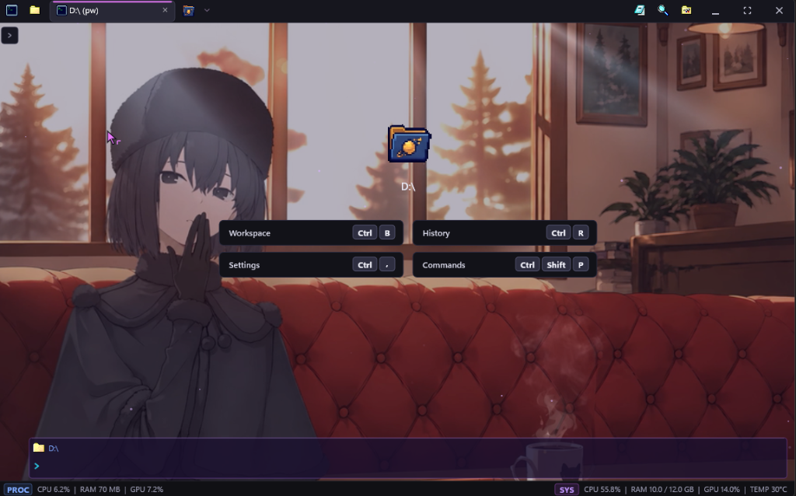
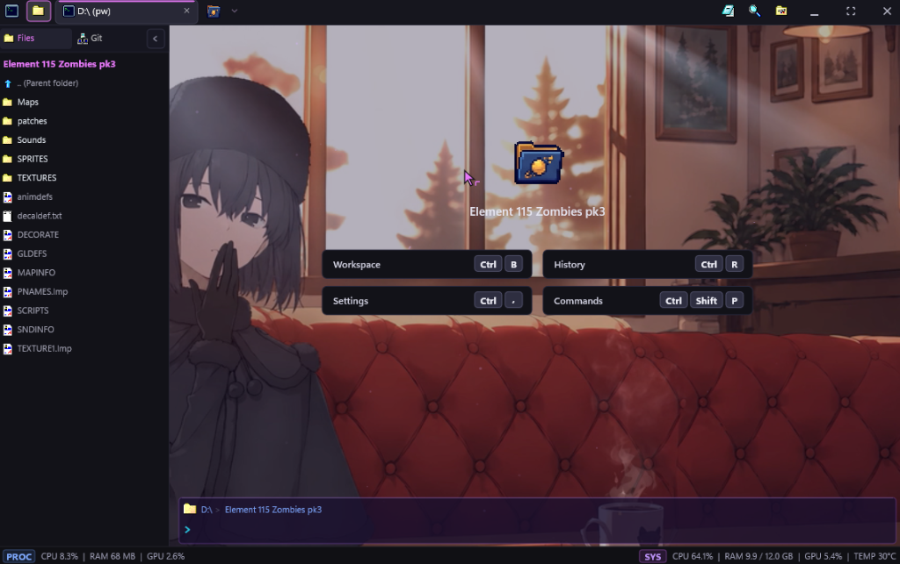
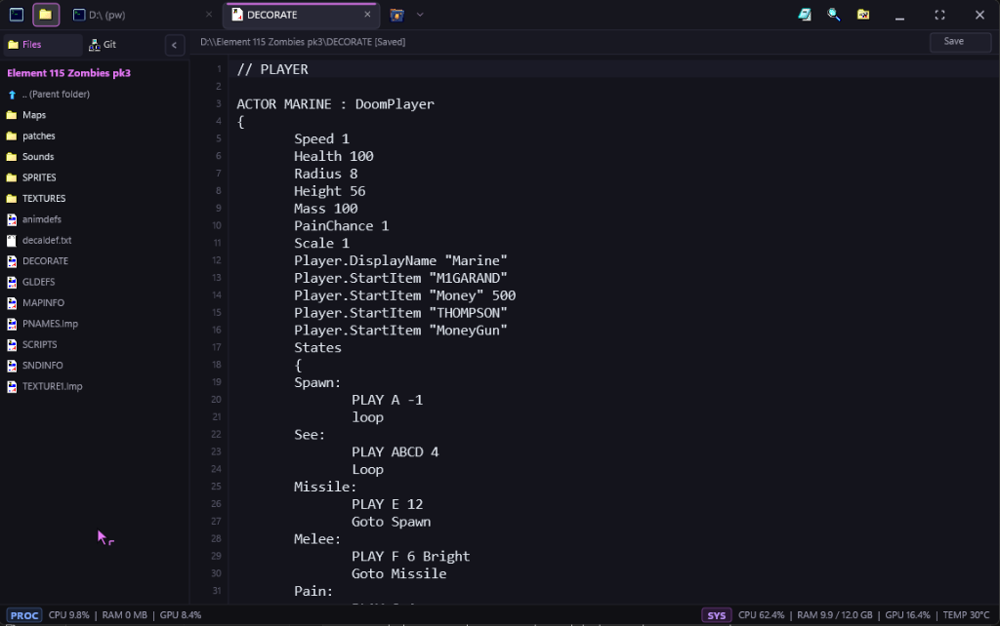
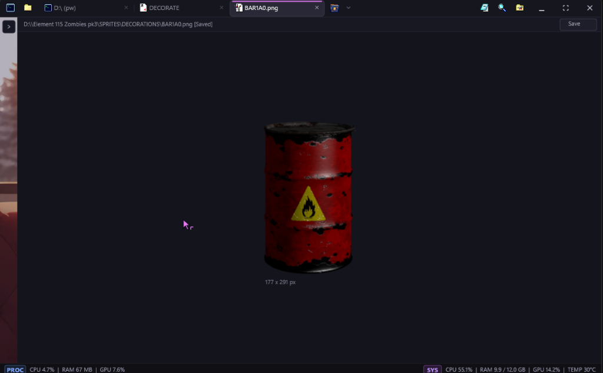
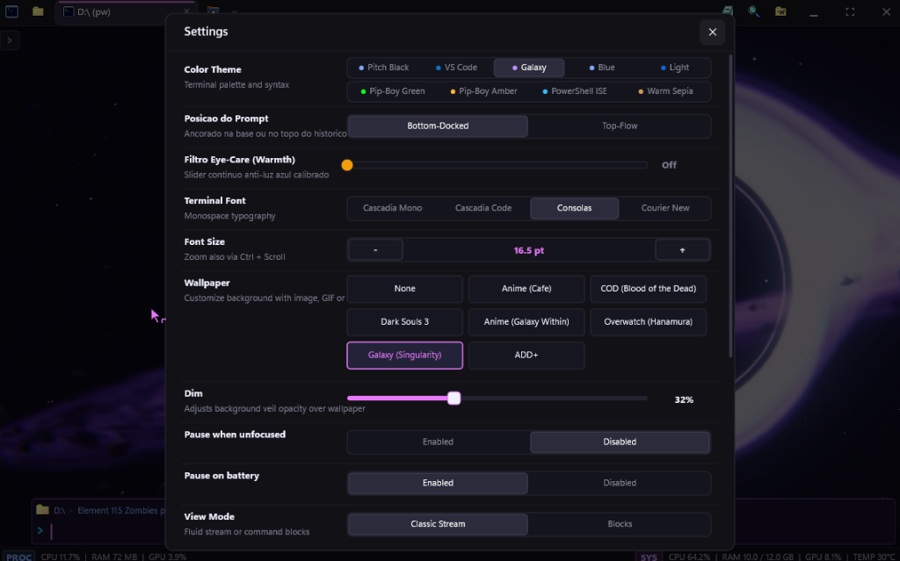

# Why Build a Custom Windows Terminal? Escaping the Boring Default CLI with C++20, ConPTY & Direct2D (Spet@term)

> **Technical Summary / Project Scope:**  
> - **Subject:** Native Windows Terminal Emulator & Micro-IDE Architecture  
> - **Language & APIs:** C++20, Win32, Direct2D 1.1, DirectWrite, DirectComposition, Windows ConPTY, Media Foundation (DXVA)  
> - **Binary Footprint:** ~1.6 MB standalone executable, 0 third-party runtime DLLs  
> - **Idle Memory:** ~3.6 MB – 18 MB working set (compared to 300+ MB on Electron alternatives)  
> - **Repository:** [github.com/Spet001/Spet-Term](https://github.com/Spet001/Spet-Term)  
> - **Author:** Eduardo Gelain (SpetDev) · November 3, 2026

---

<div style="margin: 2rem 0; padding: 1.75rem; background: linear-gradient(135deg, rgba(56, 189, 248, 0.12) 0%, rgba(15, 23, 42, 0.85) 55%, rgba(168, 85, 247, 0.15) 100%); border: 1px solid rgba(56, 189, 248, 0.35); border-left: 5px solid #38bdf8; border-radius: 1rem; box-shadow: 0 15px 40px rgba(0,0,0,0.6);">
    <div style="display: flex; align-items: center; justify-content: space-between; flex-wrap: wrap; gap: 0.75rem; margin-bottom: 0.75rem;">
        <span style="font-family: monospace; font-size: 0.75rem; font-weight: 800; letter-spacing: 0.15em; color: #38bdf8; background: rgba(56, 189, 248, 0.15); padding: 0.25rem 0.65rem; border-radius: 0.375rem; border: 1px solid rgba(56, 189, 248, 0.35);">SPETDEV HARDWARE-ACCELERATED SYSTEMS LAB</span>
        <span style="font-family: monospace; font-size: 0.75rem; color: #cbd5e1;">WIN32 CONPTY · DIRECT2D PIPELINE</span>
    </div>
    <h3 style="color: #ffffff; font-size: 1.35rem; font-weight: 800; margin-bottom: 0.5rem; letter-spacing: 0.01em;">"If you live inside the terminal every day, why settle for a boring, bloated CLI?"</h3>
    <p style="color: #cbd5e1; font-size: 0.95rem; line-height: 1.6; margin-bottom: 1.25rem;">
        Whether you are partitioning storage arrays with <code>diskpart</code>, compiling C++ game engines with Clang/LLVM, inspecting reverse engineering dumps, or orchestrating local automation scripts, a software engineer spends a massive fraction of their professional life in front of a console prompt. We built <strong>Spet@term</strong> to unite sub-millisecond native performance with game developer workflows—inline code editing, sprite inspection, and retro Win98 workspace navigation—in a featherweight 1.6 MB executable.
    </p>
    <div style="display: flex; flex-wrap: wrap; gap: 0.75rem;">
        <a href="https://github.com/Spet001/Spet-Term" target="_blank" rel="noopener noreferrer" style="display: inline-flex; align-items: center; gap: 0.5rem; padding: 0.65rem 1.35rem; background: #0284c7; color: #ffffff; text-decoration: none; border-radius: 0.6rem; font-weight: 700; font-size: 0.85rem; box-shadow: 0 6px 18px rgba(2, 132, 199, 0.35);">
            <i class="fab fa-github"></i> Inspect Spet@term Repository
        </a>
        <a href="#architecture" style="display: inline-flex; align-items: center; gap: 0.5rem; padding: 0.65rem 1.35rem; background: rgba(56, 189, 248, 0.15); color: #38bdf8; border: 1px solid rgba(56, 189, 248, 0.4); text-decoration: none; border-radius: 0.6rem; font-weight: 700; font-size: 0.85rem; font-family: monospace;">
            <i class="fas fa-microchip"></i> Jump to Direct2D / ConPTY Specs
        </a>
    </div>
</div>

---

## 1. The Genesis: Why Spend Weeks Building a Custom Terminal?

When you work deep inside Windows—from systems programming, game engine scripting (Unity, Unreal, custom C++ runtimes), reverse engineering PE binaries, and writing automation scripts, to low-level administrative tasks like managing disks with `diskpart` or troubleshooting network services—you spend hours every day inside a terminal shell.

Yet, Windows developers have historically been caught between two unsatisfactory extremes:

1. **The Classic Consoles (`cmd.exe`, standard PowerShell console):** Minimalist and reliable, but visually austere, devoid of modern developer ergonomia, lacking split tabs, modern font rendering, or contextual file awareness.
2. **The Modern Web-Based "Terminals" (Electron / WebViews):** Flashy and customizable, but monstrously resource-heavy. Spawning a 300+ MB Chromium runtime just to run a PowerShell or Bash prompt is architectural overkill. They introduce input latency, dynamic memory allocations per keystroke, and heavy CPU spikes on heavy stream outputs.
3. **Windows Terminal:** Highly capable, but still a generic container with no integrated workspace awareness, no inline asset inspection for game artists or developers, and requiring the Windows App SDK stack.

> *"If I have to spend hundreds of hours a month inside a terminal prompt, it shouldn't just be functional—it should be fast, gorgeous, and equipped with the exact tools I need to build software without constantly Alt-Tabbing away."*

That motivation sparked **Spet@term**: a standalone, native micro-IDE and terminal emulator written in **C++20** that couples the bare-metal speed of **Direct2D** with the **Windows Pseudo Console (ConPTY)** subsystem, consuming only **~3.6 MB of idle RAM** and compiling down to **~1.6 MB**.

---

## 2. Interface Tour: Beyond Just a Shell



Spet@term is engineered around developer velocity. Rather than requiring multiple external utilities to view code, inspect sprites, or track repositories, everything is accessible directly inside the host window:

### 📂 2.1. Collapsible Workspace Explorer (`Ctrl + B`)
A multi-tier filesystem drawer featuring nostalgic Win98-style iconography, breadcrumb navigation, and disk-watcher synchronization. You can explore source folders, right-click to copy paths, or launch files without opening Windows File Explorer.



### 📝 2.2. Built-in Code Editor
Need to tweak a `.json` configuration, edit a `.py` script, or review a `.md` document? Pressing Enter on any supported text file opens an inline tab with line numbering, syntax highlighting, and unsaved state tracking. It completely eliminates the need to launch an external editor for quick changes.



### 🖼️ 2.3. Inline Asset & Image Viewer
For game developers and texture artists, verifying spritesheets or UI icons usually requires a photo viewer. Spet@term embeds a native WIC-powered image inspector supporting PNG, JPEG, BMP, and ICO formats, displaying exact pixel dimensions, transparent alpha-channel checkerboards, and centered zooming.



### 🎨 2.4. Live Settings & DXVA Hardware Video Wallpapers (`Ctrl + ,`)
An integrated configuration modal allows live tweaking of theme palettes (Cyberpunk, Galaxy, Matrix, Nord), eye-care warmth adjustments, docked bottom vs. inline prompt layout (`Alt + P`), and **hardware-decoded MP4 video backgrounds** that automatically pause when unfocused to eliminate CPU/GPU drain.



---

## 3. Core Architecture & Engineering Highlights

<a id="architecture"></a>

```
src/
├── main.cpp                  # Win32 message pump, custom non-client framing, input dispatch
├── renderer_d2d.hpp          # Direct2D 1.1, DirectWrite, and DirectComposition pipeline
├── conpty_engine.hpp         # Windows ConPTY pseudo-console process management
├── terminal_screen_buffer.hpp# 2D virtual screen buffer with VT100 / alternate buffer support
├── terminal_tab.hpp          # Tab lifecycle, command block stream, and interactive state
├── wallpaper.hpp             # Media Foundation DXVA video and WIC background decoder
├── git_engine.hpp            # In-process Git repository inspection
├── workfolder.hpp            # Workspace file tree model and disk watcher
├── error_doctor.hpp          # Compiler error parsing and automated quick fixes
├── syntax_autocomplete.hpp   # Contextual command and path completion
├── themes.hpp                # Color schemes and palette definitions
└── settings.hpp              # Configuration serialization and default values
```

### 3.1. The ConPTY Subsystem & Alternate Screen Buffers
Many naive terminal implementations simply pipe stdout/stderr through anonymous pipes. This breaks interactive console programs like `diskpart`, `python`, `vim`, `htop`, or command-line LLMs.

Spet@term integrates directly with the native **Windows Pseudo Console API (`CreatePseudoConsole`)**:

```cpp
// Pseudoconsole creation and process attachment
COORD consoleSize = { static_cast<SHORT>(cols), static_cast<SHORT>(rows) };
HRESULT hr = CreatePseudoConsole(consoleSize, hPipePTYIn, hPipePTYOut, 0, &hPC);

STARTUPINFOEXW siEx = {};
siEx.StartupInfo.cb = sizeof(STARTUPINFOEXW);
// Initialize LPPROC_THREAD_ATTRIBUTE_LIST and assign PROC_THREAD_ATTRIBUTE_PSEUDOCONSOLE
UpdateProcThreadAttribute(
    siEx.lpAttributeList, 0,
    PROC_THREAD_ATTRIBUTE_PSEUDOCONSOLE,
    hPC, sizeof(HPCON), nullptr, nullptr
);

CreateProcessW(
    nullptr, cmdLine.data(), nullptr, nullptr, FALSE,
    EXTENDED_STARTUPINFO_PRESENT | CREATE_UNICODE_ENVIRONMENT,
    nullptr, currentDir.c_str(), &siEx.StartupInfo, &pi
);
```

By maintaining a dual-buffer state (`primary` and `alternate`), VT100 escape sequences like `\x1b[?1049h` and `\x1b[?1049l` cleanly switch the rendering context without polluting scrollback history.

### 3.2. Sub-Millisecond Rendering with Direct2D & DirectWrite
Text rendering in Spet@term utilizes **Direct2D 1.1** over **DirectComposition** backed by a **Direct3D 11** swap chain. Glyphs are formatted with **DirectWrite** using subpixel ClearType rendering:

* Zero intermediate bitmap copying.
* Glyph layout runs in under **0.3 ms** per frame.
* Smooth scrolling and cursor animations are synced to the monitor's native refresh rate (60Hz, 120Hz, 165Hz+).

### 3.3. In-Process Git Engine (Zero Subprocess Overhead)
Most terminal prompt extensions (such as Oh-My-Posh or Starship) spawn `git.exe status --porcelain` on every single enter key. On Windows, process spawning (`CreateProcessW`) incurs measurable latency (20ms to 60ms).

Spet@term reads `.git/HEAD`, `.git/refs/heads/`, and `.git/index` **in-process** via memory-mapped buffers:
* Branch name, commit hash, staged, and dirty states are resolved in **under 1 millisecond**.
* Zero child processes are spawned just to update the prompt status bar.

### 3.4. Hardware-Decoded MP4 Video Wallpapers with DXVA
Using **Windows Media Foundation** (`IMFSourceReader`) with DirectX Video Acceleration (DXVA), MP4 video loops are decoded directly on the GPU and bound to a Direct3D 11 texture:

* Consumes less than **0.4% GPU** during playback.
* When the window loses focus (`WM_ACTIVATE APP / WA_INACTIVE`) or is minimized, video decoding is instantly suspended, yielding **0.0% CPU and 0.0% GPU** consumption.

---

## 4. Technical Benchmarks: Spet@term vs. Modern Alternatives

| Metric | Windows Terminal | Hyper (Electron) | WezTerm | **Spet@term (C++20)** |
| :--- | :--- | :--- | :--- | :--- |
| **Language / Core** | C++ / WinUI | JavaScript / Node.js | Rust / OpenGL | **C++20 / Direct2D** |
| **Executable Size** | ~35 MB | ~110 MB | ~45 MB | **~1.6 MB** |
| **External DLL Dependencies** | Modern AppX / WinAppSDK | Full Chromium Framework | Multiple Bundled DLLs | **0 (Standard Win32)** |
| **Idle Memory (Working Set)** | ~45 MB | ~320 MB | ~65 MB | **~3.6 MB – 18 MB** |
| **Integrated Workspace Explorer** | ❌ No | ❌ Plugin required | ❌ No | **✅ Yes (Win98 Drawer)** |
| **Inline Code Editor** | ❌ No | ❌ No | ❌ No | **✅ Yes (Syntax-aware)** |
| **Inline Image Viewer** | ❌ No | ❌ No | ❌ Limited | **✅ Yes (WIC Preview)** |
| **DXVA Video Wallpaper Support** | ❌ Background image only | ⚠️ Heavy CSS Video | ❌ No | **✅ Yes (GPU Decoded)** |

---

## 5. Takeaways & Future Roadmap

Building **Spet@term** solidified an engineering truth that is easy to forget in the modern web-dominated software world: **when you write directly to the operating system's native graphics and process APIs in modern C++, you achieve a level of speed, resource efficiency, and responsiveness that web frameworks simply cannot replicate.**

A terminal shouldn't be a generic black box where you dread executing multi-step scripts. With built-in workspace exploration, instant file editing, media viewing, and hardware acceleration, your console becomes a true development command center.

The project is fully open-source on GitHub:
👉 **[https://github.com/Spet001/Spet-Term](https://github.com/Spet001/Spet-Term)**

*Grab the repository, run `.\build.ps1` with Clang, and experience how light and fast a Windows terminal can truly feel.*
